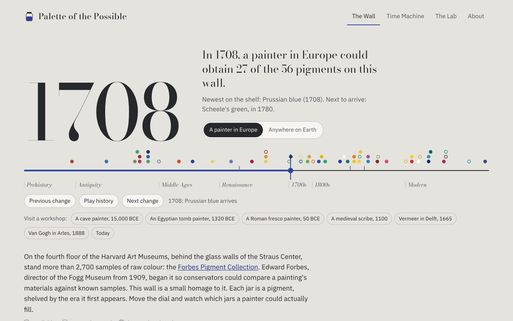
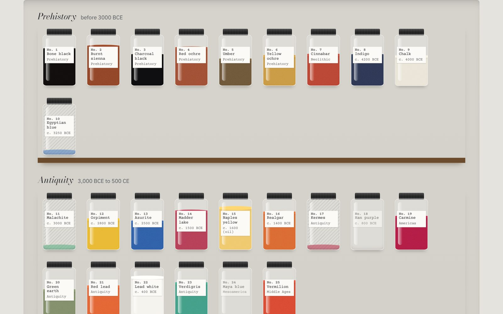
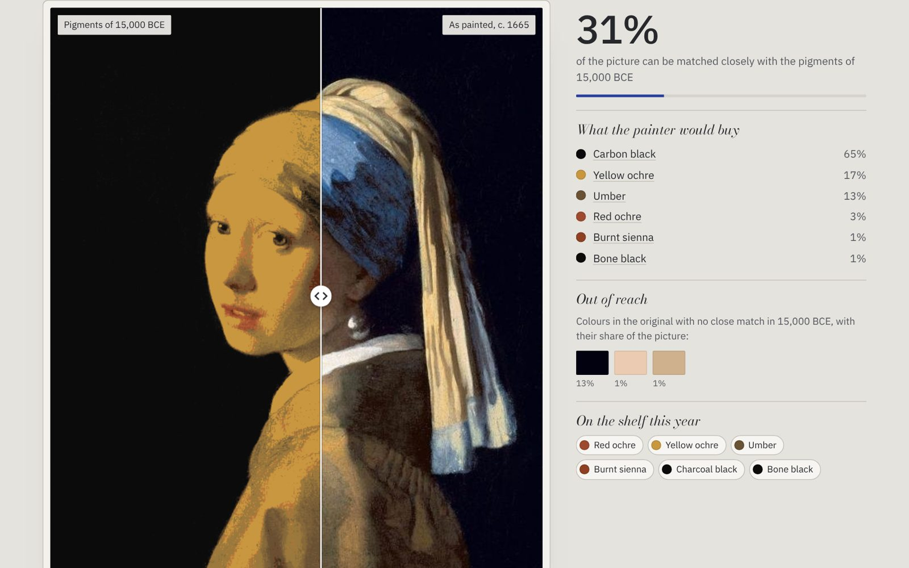
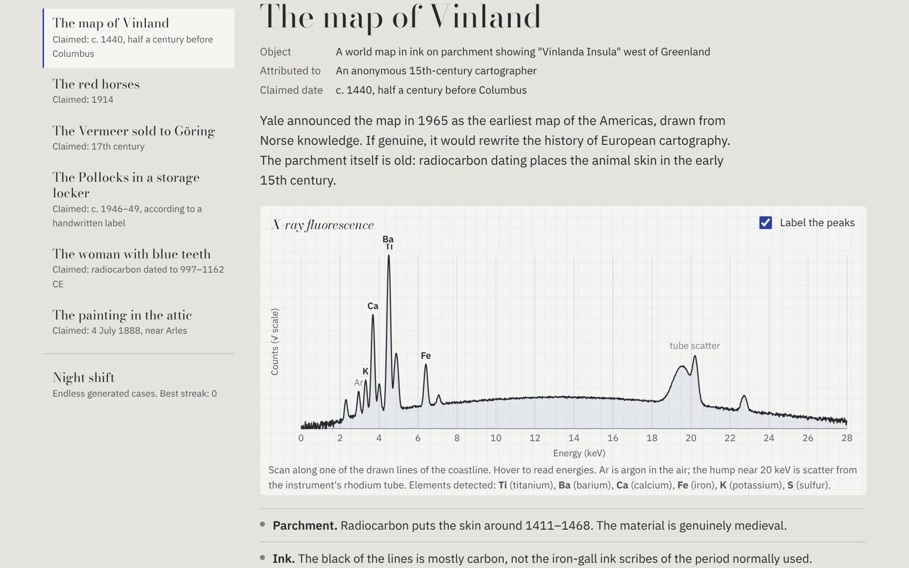

# Palette of the Possible

**A time machine for painters' pigments.** Move a dial through 42,000 years and watch which colours a painter could actually buy. Repaint *Girl with a Pearl Earring* with a cave painter's ochres, find out how much of *The Starry Night* a medieval workshop could have mixed, and use simulated X-ray spectra to catch real forgers.

**Live site: https://YOUR-GITHUB-USERNAME.github.io/palette-of-the-possible/**



Built for CS 85 (Harvard, fall 2026), for the assignment to make a software artifact that engages with art history. It is a static site with no server code, deployed on GitHub Pages.

---

## The idea

Art history is usually told through artists, patrons and styles. It can also be told through **stuff**. A painting is ground minerals, burnt bone, insect dye and coloured glass, and later the products of industrial chemistry. What a painter could make depended on what a colourman could sell, and that changed enormously over time.

- For most of history the palette was short, and some colours were precious. In 1485 Domenico Ghirlandaio's contract for an altarpiece in Florence required the blue to be ultramarine "of the value of about four florins the ounce". Lapis lazuli from Afghanistan was priced like gold.
- Then chemistry changed everything. Prussian blue (about 1706) was the first modern synthetic pigment. The 19th century brought cobalt blue, chrome and cadmium yellows, emerald green, viridian, synthetic ultramarine and cobalt violet, and from 1841 the tin tube that let painters carry them outdoors. Turner's yellow light, the Impressionists' violet shadows and the Fauves' blaze all depend on materials that had not existed a few generations earlier.
- Pigments also disappear. Lead-tin yellow, the yellow of Vermeer and Rembrandt, dropped out of use around 1750 and was forgotten until 1941. Egyptian blue was lost after antiquity. Manganese blue was discontinued in the 1990s.
- Every pigment has a birthday, so a painting's materials can date it. Titanium in a "1914" painting, or a 1986 red in a "Pollock", proves it cannot be what it claims.

The project grew out of our class visit to the **Harvard Art Museums**. On the fourth floor, through the glass walls of the Straus Center for Conservation and Technical Studies, you can see the **Forbes Pigment Collection**: more than 2,700 samples gathered from the 1910s onward by Edward Forbes, director of the Fogg from 1909. Forbes collected them so that conservators would have known materials to compare paintings against. The Straus Center, founded in 1928, is the oldest fine-arts conservation facility in the United States. Its scientists still use the collection, for example in the 2007 analysis that showed the "Matter Pollocks" contain pigments invented after Pollock's death. This site is a small digital homage to that cabinet and to the idea behind it: **materials are evidence**.

## Three rooms

### 1. The Wall
56 pigments as glass jars on oak shelves, after the Forbes cabinets, grouped by the era each first appears. The dial fills and empties the jars: available pigments are full, those not yet invented are empty, and lost ones are hatched. A switch toggles between "a painter in Europe" and "anywhere on Earth", which brings in Han purple, Maya blue, Indian yellow and others. Each jar opens a card with chemistry, first use, a short history, artworks to look for, toxicity notes, the elements an XRF instrument would detect, and sources.



### 2. The Time Machine
Choose a painting from the gallery (Leonardo, Vermeer, Turner, Hokusai, Seurat, Van Gogh, Munch, Cézanne, Matisse, Kandinsky, Monet), your own photo, a work from the **Harvard Art Museums** collection (with your own free API key, see below), or any public-domain work from the Art Institute of Chicago's open API. The image is **repainted using only colours that could be mixed from the pigments on the shelf in the chosen year**. Drag across the picture to compare. The side panel reports:

- how much of the picture can be matched closely,
- a "shopping list" of the pigments a period painter would have needed,
- the colours that were **out of reach** (also shown as an overlay),
- every pigment on the shelf that year.

A switch removes lapis ultramarine for a patron who cannot afford it. Shortcuts jump to a cave painter, an Egyptian tomb painter, a Roman fresco painter, a medieval scribe, Vermeer's Delft and Van Gogh's Arles. Two charts show the mixable colour range from above (OKLab a/b) and how its area grew over 42,000 years. Each gallery painting has a note on its documented pigments, from published technical studies, with sources.



### 3. The Lab
Six real cases in which materials told the truth, each with a simulated XRF spectrum, lab notes, questions and a reveal with sources:

| Case | Claimed | What gave it away |
|---|---|---|
| The Vinland Map (Yale) | c. 1440 | Anatase titanium white in every ink line (McCrone 1974; Yale 2021) |
| Beltracchi's "Campendonk", *Red Picture with Horses* | 1914 | Titanium white, first made as a pigment around 1916–19 |
| Van Meegeren's "Vermeer", sold to Göring | 17th c. | Cobalt blue (not smalt) and a Bakelite-type resin; later, lead-210 dating |
| The "Matter Pollocks" (Harvard Straus Center, 2007) | c. 1946–49 | Pigment Red 254, first sold in 1986. XRF alone could *not* catch it |
| The woman with lapis in her teeth (Dalheim, 2019) | 997–1162 CE | Not a forgery: lazurite in dental calculus reveals a medieval woman painter |
| Van Gogh's *Sunset at Montmajour* (2013) | 1888 | Not a forgery: nothing anachronistic, so letters and canvas evidence decided |

The cases teach real limits of the method: XRF reports elements, not compounds (cobalt could be smalt *or* cobalt blue), it cannot see organic pigments, and some peaks overlap (barium and titanium, arsenic and lead). The **Night shift** mode generates endless cases from the pigment database: a dated "painting", a spectrum, and the question of whether any element is impossible for that year.



## What the model shows

Some findings from the colour model, for European painters. Numbers come from `npm run check` and the Time Machine.

**Share of today's mixable colour range (area in the OKLab a/b plane):**

| Year | Pigments on the shelf | Share of today's range |
|---|---|---|
| 40,000 BCE | 6 (earths and blacks) | 6% |
| 1 CE | 15 | 48% |
| 1000–1503 | 21–23 | 67% |
| 1700 | 27 | 78% |
| 1850 | 35 | 96% |
| 1950 | 41 | 98% |

**Share of each painting that can be matched closely** (OKLab ΔE < 0.04):

| Painting | 15,000 BCE | 1100 | Its own date |
|---|---|---|---|
| Leonardo, *Mona Lisa* | 41% | 99% | 99% |
| Vermeer, *Girl with a Pearl Earring* | 31% | 85% | 87% |
| Hokusai, *The Great Wave* | 2% | 100% | 100% |
| Van Gogh, *The Starry Night* | 14% | 100% | 100% |
| Matisse, *Woman with a Hat* | 10% | 79% | 92% |
| Monet, *Water Lilies* | 3% | 91% | 97% |

Three things surprised me:

1. **A rich medieval workshop could already reach about two-thirds of today's colour range**, and most of the hues in a Van Gogh. What the 18th and 19th centuries changed first was **price, permanence and convenience**: Prussian blue at a fraction of the cost of lapis, synthetic ultramarine, cheap bright yellows, paint in tubes. Even the famous lapis matters less to the *range* than you might expect: in the Time Machine, switching off the "rich patron" checkbox barely changes the score (*The Starry Night* in 1503 drops from 100% to 96%), because azurite, smalt and indigo cover most blue hues. What lapis bought was depth, a violet-leaning intensity, permanence and prestige.
2. **The gains at the edges are real.** Saturated greens, oranges and violets arrive with emerald green (1814), the cadmiums (1840s) and cobalt violet (1859). Matisse's *Woman with a Hat* is the gallery painting least reachable by a medieval painter.
3. **Before about 3000 BCE the palette is earth and soot.** Blue simply does not exist for painters until Egyptian blue, which is why *The Great Wave* drops to almost nothing.

## How it works

Plain HTML, CSS and JavaScript modules. No framework, no build step, no server. GitHub Pages serves the files as they are.

```
index.html            page structure for the four views
css/style.css         design: plaster, graphite, oak; lapis as the only accent
js/main.js            store, hash router, shared controls
js/time.js            non-linear time scale, availability logic
js/timeline.js        the dial: slider, pigment-arrival ticks, play, keyboard
js/wall.js            the cabinet of jars
js/drawer.js          pigment detail panel (<dialog>)
js/color.js           sRGB/linear/OKLab conversions, Kubelka–Munk mixing
js/gamut.js           everything a palette can mix; convex hull
js/mixer-worker.js    Web Worker: lookup table, repainting, statistics
js/machine.js         Time Machine UI and charts (SVG)
js/aic.js             Art Institute of Chicago API search
js/harvard.js         Harvard Art Museums API search (visitor's own key)
js/xrf.js             XRF line table and spectrum simulator
js/lab.js             case files and the Night shift generator
js/data/*.js          pigments, paintings, cases (the research lives here)
scripts/check-data.mjs   data sanity checks (npm run check)
scripts/prodia_repaint.py optional image-model comparison (see below)
```

**Dates.** Each pigment has two spans, `world` (in use anywhere) and `eu` (obtainable by a painter in Europe), each `[from, to]`. A `to` date marks a pigment that was lost or abandoned. The dial uses a piecewise-linear scale: prehistory is compressed and the crowded 19th century is stretched.

**Mixing.** Each pigment has an sRGB approximation of its full-strength colour and a tinting strength. Mixtures use **single-constant Kubelka–Munk theory**, the standard first model for paint, evaluated per RGB band: `K/S = (1 − R)² / 2R`, added in proportion to amount × strength, then inverted. This reproduces paint's subtractive behaviour: blue and yellow make green. For a given year the program builds every pigment, every pair at four ratios, tints of each with the brightest white and with lead white, shades with black, and thin glazes of transparent pigments over black (the deep darks of Old Master backgrounds). After deduplication in OKLab, that is between about 50 and 14,000 colours.

**Repainting.** A Web Worker indexes the mixable colours in a 3-D grid over **OKLab**, a perceptually uniform colour space. It then builds a 33×33×33 lookup table that maps every point of the RGB cube to its nearest mixable colour, with lightness weighted 1.4× because painters protect values first. Every pixel goes through the table with trilinear interpolation. A pixel counts as matched when the result is within 0.04 of the original in OKLab, about two just-noticeable differences. Repainting a 900-pixel image takes about 0.2 s. Black pigments are given the deepest value a photograph records, which is the black-point compensation colour management uses.

**Gamut chart.** The area of the convex hull of all mixable colours in the OKLab a/b plane (hue and chroma, ignoring lightness), as a share of today's.

**XRF.** Peaks sit at true emission-line energies from the LBNL *X-ray Data Booklet* (Table 1-2). The simulation includes energy-dependent detector resolution, air absorption of light elements, a rhodium-tube scatter peak and Compton hump, a continuum, and counting noise. Heights are illustrative, not quantitative.

**Night shift.** The generator picks a year and a period-correct palette. About half the time it slips in one pigment whose characteristic element appeared later than the claimed date, preferring near anachronisms, as a real forger's mistakes would be. Answers are computed from the same database the Wall uses, and any element that is impossible for the year counts as correct. A fuzz test of 3,000 generated cases found no inconsistent answers.

**Harvard Art Museums search and API keys.** The Harvard API requires a personal key, so the site never contains one. Visitors paste their own key into the Time Machine's Harvard tab. The key is kept only in that browser: in `sessionStorage` (cleared when the tab closes) or, if the visitor ticks "remember", in `localStorage`. It is sent only to `api.harvardartmuseums.org`, never put in the page URL, and "Forget key" deletes it. Images come from Harvard's IIIF image server. Works whose images Harvard withholds for rights reasons (many 20th-century works) are skipped. You can [request a free key from Harvard](https://docs.google.com/forms/d/1Fe1H4nOhFkrLpaeBpLAnSrIMYvcAxnYWm0IU9a6IkFA/viewform); see the [API docs](https://github.com/harvardartmuseums/api-docs).

**Quality.** The site works with the keyboard throughout (Page Up and Page Down on the dial jump between pigment arrivals). It respects reduced-motion settings, offers a table view for the range chart, and is responsive down to phone width. Fonts are self-hosted.

## Research and sources

Pigment dates, chemistry and artwork attributions come from **ColourLex**, **CAMEO** (Museum of Fine Arts, Boston), the **National Gallery Technical Bulletin**, WebExhibits' *Pigments through the Ages*, museum technical studies (Mauritshuis, Art Institute of Chicago, MoMA/RIT, Nasjonalmuseet) and peer-reviewed papers. Each pigment card and case file lists its own sources. Where dates are disputed (Maya blue, cobalt violet, cadmium red, Hansa yellow, the first use of lapis ultramarine), the site uses the date from which a working painter could realistically obtain the pigment and says so. Gallery notes are marked when a list comes from the artist's documented palette rather than an analysis of that exact painting.

## Limitations

- Screen colour is not pigment: particle size, gloss, translucency and binder matter, and the most saturated pigments are outside sRGB.
- Three-band Kubelka–Munk is an approximation of full spectral mixing.
- "Available" is not "affordable" or "used". Trade, guild rules and taste shaped real palettes, and the patron switch models only the most famous case.
- The European timeline is better documented than others; "Anywhere on Earth" is a sample of the world's colour traditions, not a survey.
- Paintings change. The "original" is the painting as it looks today, faded reds and browned yellows included.

## Running it

```bash
git clone <this repo> && cd palette-of-the-possible
python3 -m http.server 8000      # then open http://localhost:8000
npm run check                    # optional: validate the data files (Node 18+)
```

ES modules and Web Workers need a web server; opening `index.html` as a file will not work. To deploy, enable GitHub Pages for the `main` branch, root folder.

### Optional: ask an image model the same question

`scripts/prodia_repaint.py` asks an image model, through the course's Prodia proxy, to repaint gallery works using only a given year's pigments. The Time Machine then shows the model's guess under the painting, next to the colour-science result. The model invents convincing brushwork, but it has no idea which colours were physically mixable. Run it on your own computer with the key in an environment variable. The key is never put in the site or the repository.

```bash
export PRODIA_PROXY_KEY='you@college.harvard.edu|XXXXXXXXXXXXXXXX'
python3 scripts/prodia_repaint.py --dry-run     # prompts and cost estimate, spends nothing
python3 scripts/prodia_repaint.py --model klein # drafts, about $0.004 each
python3 scripts/prodia_repaint.py               # Nano Banana, about $0.24 for all six
```

## Credits

- Painting images are public-domain photographs of public-domain works, redistributed in open-source research repositories. Search results come from the [Harvard Art Museums API](https://github.com/harvardartmuseums/api-docs) (with the visitor's key) and the [Art Institute of Chicago API](https://api.artic.edu/docs/), limited to images each museum makes openly available.
- Typefaces under the SIL Open Font License: Bodoni Moda (Owen Earl), IBM Plex Sans (IBM), Courier Prime (Alan Dague-Greene). Licence texts are in `fonts/`.
- XRF energies: Lawrence Berkeley National Laboratory, *X-ray Data Booklet*.
- Inspiration: the Forbes Pigment Collection and the Straus Center for Conservation and Technical Studies, Harvard Art Museums.

**How this was made.** As the course encourages, I built this with Claude, an AI assistant, which helped with research, code and copy. I directed the concept and design and checked the facts against the sources cited. The colour model, the repainting and the XRF simulation are deterministic code; no generative image model is used in the core experience.
